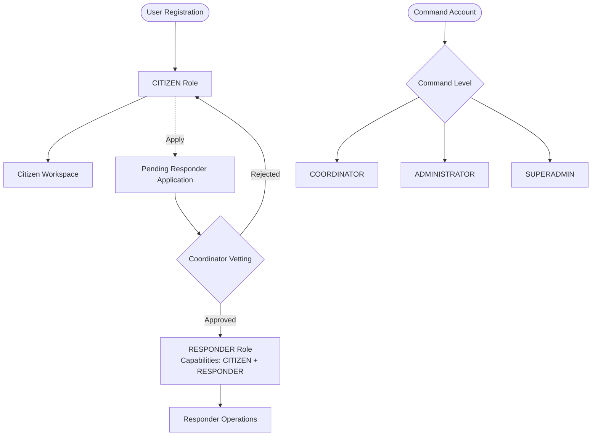

# BeaconMesh

> **Every signal finds its way.**<br/>
> Decentralized Emergency Communication & Humanitarian GIS Platform.

[](#testing--verification)
[](#gis--mapping-architecture)
[](#firebase-configuration--spark-tier)
[](#architecture--technology-stack)
[](#license--disclaimer)

---

## Table of Contents

1. [Overview & Problem Statement](#overview--problem-statement)
2. [Frozen Role Architecture & Operational Security](#frozen-role-architecture--operational-security)
3. [GIS & Mapping Architecture](#gis--mapping-architecture)
4. [Current Implementation vs. Planned Innovation](#current-implementation-vs-planned-innovation)
5. [Architecture & Technology Stack](#architecture--technology-stack)
6. [Prerequisites & Getting Started](#prerequisites--getting-started)
7. [Environment Configuration](#environment-configuration)
8. [Firebase Configuration & Spark Tier](#firebase-configuration--spark-tier)
9. [Testing & Verification](#testing--verification)
10. [Production Build & Deployment](#production-build--deployment)
11. [GIS Attribution & Esri Terms Compliance](#gis-attribution--esri-terms-compliance)
12. [License & Disclaimer](#license--disclaimer)

---

## Overview & Problem Statement

During major natural catastrophes—such as severe flooding, tropical cyclones, earthquakes, or wildfires—terrestrial cellular infrastructure, fiber optic backbones, and power grids frequently collapse or become overwhelmed. In these critical operating windows, centralized emergency applications and online dispatch hubs become unreachable for victims and first responders.

**BeaconMesh** is an offline-resilient, delay-tolerant emergency communication and humanitarian GIS platform designed to maintain situational awareness and life-safety coordination when the internet is unavailable.

### Core Capabilities

- **Offline-First Incident Creation & Queueing**: Citizens can lodge structured SOS beacons and damage reports entirely offline. Reports are staged in client-side IndexedDB (`Dexie`) and opportunistically synchronized once connectivity is restored.
- **Dual-Capability Responder Lifecycle**: Field responders benefit from unified workflows. Approved responders automatically receive dual capabilities (`['CITIZEN', 'RESPONDER']`), enabling them to report personal emergencies while actively responding to dispatch tasks.
- **Humanitarian GIS Command Console**: Integrated 2D and 3D terrain visualization, split-screen synchronized comparison, swipe analysis, offline vector and raster caching, Living Atlas citation metadata inspection, and ground sample distance (GSD) transparency.
- **Audited State-Machine Security**: Production-hardened Firestore Security Rules protecting against privilege escalation, unapproved dispatch tampering, unauthorized capability elevation, and data poisoning.

---

## Frozen Role Architecture & Operational Security

BeaconMesh enforces an immutable, three-tier primary role model with strict separation of privileges.

### Primary Application Roles

1. `CITIZEN`
   - The default role for all registered citizens.
   - Capabilities: Submit emergency SOS beacons, view verified Safe Zones, track own incident lifecycle, access offline survival guides.
2. `RESPONDER`
   - Verified field personnel (EMT, Fire, SAR, Police, Volunteer).
   - Approval Workflow: Begins in `PENDING` status with zero responder capabilities until explicitly vetted and approved by a Command Coordinator.
   - Dual Capability: Once approved, the user gains `['CITIZEN', 'RESPONDER']` capabilities.
3. `COMMAND`
   - Incident coordinators, operational leadership, and system administrators.
   - Hierarchical Permission Levels (`commandLevel`):
     - `SUPERADMIN`: Full system authority, administrative provisioning, emergency policy configuration.
     - `ADMINISTRATOR`: User lifecycle management (suspension, reactivation), basic profile updates. Generic updates restricted to non-operational fields (`accountStatus`, `displayName`, `phoneNumber`, `photoURL`, `updatedAt`).
     - `COORDINATOR`: Operational field dispatch, responder application vetting, incident management.



---

## GIS & Mapping Architecture

The humanitarian map console is built on the **ArcGIS Maps SDK for JavaScript 5.x** (`@arcgis/core@5.2.5`), providing professional spatial intelligence without requiring expensive custom map servers.

### Key Map Modules

| Component | Description |
| :--- | :--- |
| `MapViewContainer` | High-performance 2D WebGL map container with automated WebGL context reclamation and clean container lifecycle. |
| `SceneViewContainer` | 3D terrain viewer utilizing Esri World Elevation with satellite imagery draped over real-world topography. |
| `ComparisonView` | Split-screen synchronized dual-viewport with independent basemap/layer controls and linked navigation. |
| `SwipeComparison` | Interactive swipe bar for before-and-after disaster impact assessment and imagery verification. |
| `ImageryInspector` | Resolution transparency utility calculating native source GSD vs display GSD with latitude correction. |
| `CitationOverlay` | Real-time ArcGIS Living Atlas citation and metadata inspector exposing imagery capture date and provider attribution. |
| `MeasurementTools` | Client-side geodetic distance and area calculation using `@arcgis/core/geometry/operators`. |

---

## Current Implementation vs. Planned Innovation

To maintain complete transparency and academic integrity, the following matrix distinguishes between features that are currently implemented and verified versus capabilities planned for future research phases.

### Verified & Implemented Today

- [x] Full TanStack Start + Nitro SSR + React application architecture.
- [x] Comprehensive client-side routing with role-based route guards (`src/routes/`).
- [x] Firestore security state machine and role constraints with 40 emulator-verified security tests.
- [x] Dual-capability responder workflow and registration pipeline.
- [x] Complete ArcGIS Maps SDK 2D/3D console with layer controls, swipe comparison, and measurement tools.
- [x] Client-side offline storage via Dexie IndexedDB (`IncidentService`, `SafeZoneService`).
- [x] Verified Safe Zones discovery, status visualization, and public access.
- [x] Mock simulation sandbox for testing incident dispatch workflows and map pin interactions.

### Planned for Future Engineering (Network Innovation Engine)

- [ ] **Delay-Tolerant Networking (DTN) Engine**: Autonomous store-carry-forward epidemic packet routing between mobile devices.
- [ ] **Physical Radio Hardware Abstraction**: Real Bluetooth Low Energy (BLE) peripheral/central GATT service integration.
- [ ] **Long-Range (LoRa) Transceiver Bridge**: Serial/USB integration with physical Semtech SX1262/SX1276 LoRa radios for off-grid backhaul.
- [ ] **Cryptographic Mesh Signatures**: End-to-end asymmetric message signing and verifiable relay provenance across untrusted nodes.

> **Disclaimer**: BeaconMesh does not currently transmit packets over physical BLE or LoRa radio hardware. All current peer-to-peer and routing demonstrations operate within simulated memory environments.

---

## Architecture & Technology Stack

```
BeaconMesh/
├── .output/             # Generated Nitro SSR and client build output (gitignored)
├── public/              # Static web assets, branding icons, robots.txt
├── scripts/             # Administrative maintenance & dry-run migration scripts
├── src/
│   ├── assets/          # Application media & asset definitions
│   ├── components/      # UI component library
│   │   ├── beaconmesh/  # Domain-specific components (Auth, Dashboard, Navigation)
│   │   ├── gis/         # ArcGIS 2D/3D, Swipe, Comparison, Measurement widgets
│   │   └── ui/          # Radix UI + Tailwind design system primitives
│   ├── hooks/           # Responsive layout & interaction hooks
│   ├── lib/             # Core services, types, and business logic
│   │   ├── db/          # Dexie IndexedDB client database schema
│   │   ├── gis/         # Geodetic calculations, resolution utils, citation services
│   │   ├── services/    # Incident, SafeZone, and Disaster layer services
│   │   ├── auth-types.ts# Canonical user profiles, roles, and schema invariants
│   │   ├── firebase.ts  # Firebase SDK initialization with graceful fallback
│   │   └── user-service.ts# Firestore profile operations & sync logic
│   ├── routes/          # TanStack Start file-based route tree
│   └── test/            # Vitest unit, integration, and Firestore emulator tests
├── firebase.json        # Firebase configuration & emulator definitions
├── firestore.rules      # Audited Firestore Security Rules
└── package.json         # Project manifest & dependency lockfile
```

### Core Technologies

- **UI Framework**: React 18 / 19, TypeScript 5.x
- **Meta-Framework**: TanStack Start, TanStack Router, Nitro Server Engine
- **Styling**: Tailwind CSS, PostCSS, Lucide Icons, Radix UI Primitives
- **Spatial Intelligence**: `@arcgis/core` v5.2.5 (ArcGIS Maps SDK for JavaScript)
- **Database & Identity**: Google Firebase Auth & Cloud Firestore (Spark Tier compatible)
- **Local Database**: Dexie.js (IndexedDB client cache)
- **Testing**: Vitest, `@testing-library/react`, `@firebase/rules-unit-testing`

---

## Prerequisites & Getting Started

### Prerequisites

- **Node.js**: Version `20.x` or `22.x` LTS
- **npm**: Version `10.x` or higher
- **Java JRE / JDK**: Version `11` or higher (required only if running the local Firestore Emulator)

### Installation

Clone the repository and install dependencies using the verified lockfile:

```bash
git clone https://github.com/kethankumarchettipalli/BeaconMesh.git
cd BeaconMesh

# Install dependencies strictly from package-lock.json
npm ci
```

---

## Environment Configuration

Copy the example environment configuration template to create your local environment file:

```bash
cp .env.example .env.local
```

Populate `.env.local` with your Firebase project credentials. For local testing without a live Firebase project, the application automatically operates in mock demonstration mode with local IndexedDB fallback:

```env
# Firebase Spark Free Tier Web App Configuration
VITE_FIREBASE_API_KEY=your_firebase_api_key_here
VITE_FIREBASE_AUTH_DOMAIN=your_project_id.firebaseapp.com
VITE_FIREBASE_PROJECT_ID=your_project_id
VITE_FIREBASE_STORAGE_BUCKET=your_project_id.firebasestorage.app
VITE_FIREBASE_MESSAGING_SENDER_ID=your_messaging_sender_id
VITE_FIREBASE_APP_ID=your_firebase_app_id
```

> **Security Note**: Never commit `.env` or `.env.local` to source control. Both are strictly ignored in `.gitignore`.

---

## Firebase Configuration & Spark Tier

BeaconMesh is engineered to operate 100% within Google Firebase's free **Spark Tier** without requiring Cloud Functions or paid billing:

- **Authentication**: Email/Password, Anonymous login, and Email Verification.
- **Firestore Database**: Client-SDK reads and writes governed strictly by `firestore.rules`.
- **Local Emulation**: Test security rules and application behavior without incurring cloud usage or network latency:

```bash
# Launch Firestore Local Emulator on port 8088
npx firebase-tools emulators:start --only firestore
```

The Firestore Emulator UI is available at `http://127.0.0.1:4000/firestore`.

---

## Testing & Verification

The BeaconMesh test suite covers authentication logic, route guards, spatial mathematics, dual-capability invariants, and security rules against the real Firestore emulator.

```bash
# Run the complete automated test suite (162 tests)
npm test

# Run tests in watch mode
npm run test:watch
```

### Test Suite Structure

- `src/test/real-firestore-emulator.test.ts`: 40 security tests against the real Firebase emulator verifying zero unauthorized capability elevation, invariant protection, and anti-tamper constraints.
- `src/test/dual-capability-authorization.test.ts`: Unit tests validating dual-capability granting, coordinate fallbacks, and user normalization.
- `src/test/gis-batch*.test.ts`: Verification of ArcGIS view containers, split comparisons, swipe widgets, and resolution utilities.
- `src/test/app-routing.test.tsx`: Route guard evaluation and unauthorized redirection tests.

---

## Production Build & Deployment

To compile the production client bundle and Nitro server engine:

```bash
# Production client and SSR build
npm run build

# Preview the production build locally
npm run preview
```

The build outputs:
- `.output/public`: Client assets and static pages.
- `.output/server`: Nitro server bundle for deployment to any Node.js host, Cloudflare Workers, or Netlify.

---

## GIS Attribution & Esri Terms Compliance

BeaconMesh utilizes Esri basemaps and elevation services provided through the ArcGIS Maps SDK. In compliance with the Esri Master License Agreement and ArcGIS Developer Terms of Use:

1. **Attribution Display**: Standard attribution text is visibly preserved on all map instances (`attributionVisible: true`).
2. **Zero-Cost Access**: The application utilizes publicly accessible ArcGIS Living Atlas basemaps and elevation layers within free-tier developer guidelines.
3. **Data Sources**: Map tiles and imagery are sourced from Esri, Maxar, Earthstar Geographics, USDA, USGS, AeroGRID, IGN, and the GIS User Community.

---

## License & Disclaimer

### Academic & Prototype Disclaimer

BeaconMesh is an experimental research and development project. It is not an officially certified 911/emergency dispatch platform and must not be used as the sole communication system during life-threatening emergencies. In active disasters, always utilize official local emergency services and civil defense frequencies where available.

### License

Distributed under the MIT License. See `LICENSE` for details.
